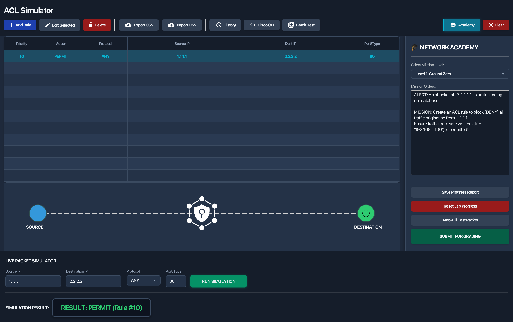
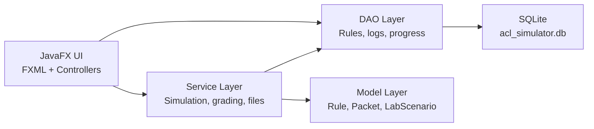

# ACL Simulator

ACL Simulator is a JavaFX desktop application for building, testing, and learning
network Access Control Lists. It combines a rule table, packet simulator,
visual topology animation, Cisco IOS config generation, batch testing, history
logging, and an Academy mode with auto-graded lab scenarios.



## Feature Highlights

- **ACL rule engine:** first-match evaluation with implicit deny behavior.
- **Advanced matching:** exact IP, CIDR, wildcard mask, protocol, port range,
  and ICMP type handling.
- **Rule management:** create, edit, delete, reorder, import, and export rules.
- **Visual simulation:** animated source-to-router-to-destination packet flow.
- **Cisco generator:** converts GUI rules into Cisco IOS-style ACL commands.
- **Batch testing:** imports packet lists and runs them through the simulator.
- **Academy mode:** 8 scenario-based labs with grading, hints, attempts, and
  completion tracking.
- **Audit reports:** exports structured student progress and simulation history.
- **SQLite persistence:** local database for rules, logs, and lab progress.

## Screenshots


## Architecture



## Project Structure

```text
ACLSimulator/
├── pom.xml
├── DEVELOPMENT.md
├── CODEBASE.md
├── TROUBLESHOOTING.md
├── run.sh
├── run.bat
└── src/
    ├── main/java/com/aclsim/
    │   ├── MainApp.java
    │   ├── MainController.java
    │   ├── AddRuleController.java
    │   ├── Launcher.java
    │   ├── database/
    │   ├── model/
    │   └── service/
    └── test/java/com/aclsim/service/
```

## Requirements

- Java 17 or newer
- Maven 3.8 or newer

JavaFX dependencies are managed by Maven.

## Run From Source

```bash
cd ACLSimulator
mvn clean javafx:run
```

## Run Tests

```bash
cd ACLSimulator
mvn test
```

## Build The Release JAR

```bash
cd ACLSimulator
mvn clean package
```

The runnable JAR is generated at:

```text
ACLSimulator/target/ACLSimulator.jar
```

Launch it with:

```bash
java -jar target/ACLSimulator.jar
```

Or use the launcher scripts:

```bash
./run.sh
```

```bat
run.bat
```

## Documentation

- [Development process](ACLSimulator/DEVELOPMENT.md)
- [Codebase atlas](ACLSimulator/CODEBASE.md)
- [Troubleshooting guide](ACLSimulator/TROUBLESHOOTING.md)
- [v5.0 roadmap](plans/v5.0 plan.md)
- [v4.0 roadmap] (vplans/v4.0 plan.md)
- [v3.0 roadmap] (plans/v3.0 plan.md)
- [v2.0 roadmap] (plans/v2.0 plan.md)
